# Somerset Pudong Riverside · 电视门户复刻

酒店电视门户的 HTML 复刻：截图铺底 + 少量代码做动效，遥控 / 键盘 / 鼠标共用一套焦点逻辑。

- 页面：`tv.html`（模拟电视 + 遥控，演示入口）、`boot.html`（通用开机 → 欢迎）、`index.html`（盛捷首页）、`hotel.html`（酒店介绍）、`parkyard.html`（博雅首页）、`laundry.html`（自助洗衣）、`novotel-boot.html`（诺富特开机 + 欢迎轮播）、`novotel.html`（诺富特主页）、`novotel-list.html`（诺富特列表式栏目：温馨客房 / 餐厅&酒吧）、`hampton-boot.html`（希尔顿欢朋开机）、`hampton.html`（欢朋主页）、`hampton-hotel.html`（欢朋 · 酒店栏目）、`hampton-detail.html`（欢朋 · 客房 / 餐厅 / 休闲详情）
- 四家酒店：盛捷（somerset）、博雅（parkyard）、诺富特（novotel）、希尔顿欢朋（hampton）；电视左右两侧的 `‹ ›` 切换，切换后重走该店的开机流程
- 素材：全部 1920×1080，放在 `assets/` 下按用途分了 `brand / photos / screens` 三类
- 校验图：`preview/`（渲染截图、与参考图 50% 叠加图）

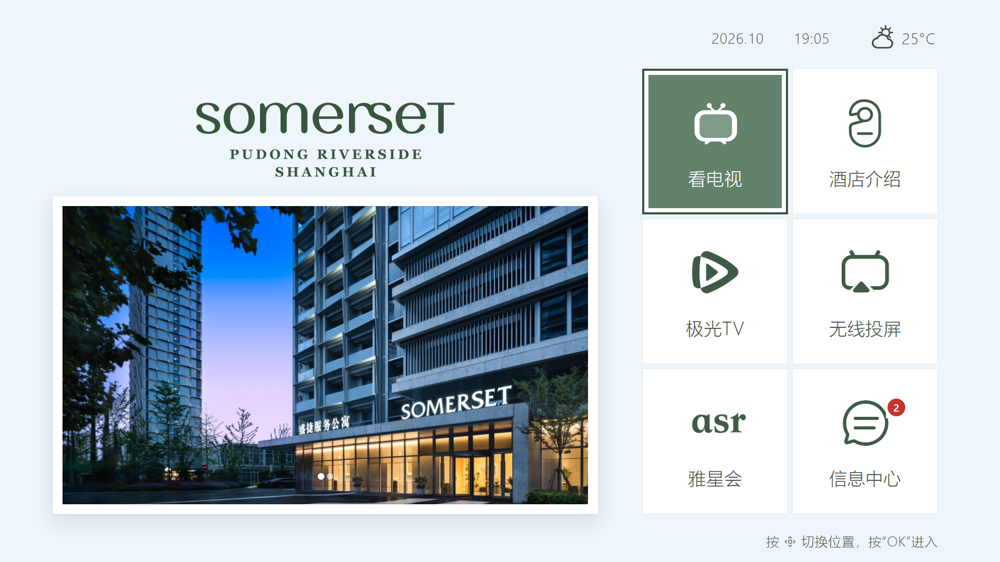

---

## 一、怎么预览

**方式一：起本地服务（推荐，面试现场用这个）**

```bash
node server.js          # 默认 http://127.0.0.1:8080
node server.js 3000     # 换端口
```

Windows 下也可以直接双击 **`start-server.bat`**。启动后终端只打印本机地址：

```
作品集服务已启动（仅本机可访问）
地址：  http://127.0.0.1:8080/
```

- `/` 默认打开作品集主页 `tv.html`；
- 改完页面对照着刷新即可（服务禁了缓存）；
- 服务只监听 `127.0.0.1`，**局域网内其他设备访问不到**；要放开时把 `server.listen(PORT, '127.0.0.1')` 改成 `'0.0.0.0'`。

**方式二：直接双击 HTML**

1. 双击 **`tv.html`**：左边电视、右边遥控，电视里先走 2 秒开机页 → 欢迎信 → 首页（按 OK 进入），点遥控就能操作；电视两侧的 `‹ ›` 切换酒店；
2. 也可以单独开 `index.html`，键盘当遥控器（方向键 / `Enter` / `Esc`）；
3. 按 `F11` 全屏，页面按 1920×1080 绘制并整体等比缩放，不出现滚动条、不裁切。

> 机器人送物那屏要真下单，需要另开 mock 服务：`cd D:\delivery-server && node index.js`（端口 3001，已开 CORS）。没开也不影响演示，页面会自动走离线版。

## 二、已实现的交互

| 操作 | 键盘 | 效果 |
|---|---|---|
| 移动焦点 | `←` `→` `↑` `↓` | 宫格内循环移动，选中项墨绿底 + 深绿外框 + 内侧白环，图标文字转白 |
| 进入 | `Enter` / `Space` / `OK` | 有截图的栏目 → 铺整页截图；酒店介绍 → 跳 `hotel.html`；还没截图的（看电视）→ 占位页 |
| 翻页 | `←` `→` | 详情页内左右翻页（信息中心 2 页） |
| 返回 | `Esc` / `Backspace` | 关详情 / 回上一级；`hotel.html` 上再按一次回首页 |
| 数字直达 | `1`–`6` | 跳到第 N 个栏目 |
| 切换主图 | 点圆点 / 拖拽 / `PageUp`·`PageDown` | 有几张播几张（现 2 张），6 秒自动切换 |

调试参数：`index.html?open=aurora`（或 `?open=3`）直接打开某栏目，`?open=info&shot=2` 停在详情第 2 页，`?slide=2` 停在第二张主图，`hotel.html?focus=3` 指定焦点，`boot.html#welcome` 跳过开机等待。

## 三、项目结构

```
server.js                 # 零依赖静态服务（node server.js [端口]，仅本机可访问）
start-server.bat          # 双击启动（Windows）
tv.html                   # 模拟电视 + 虚拟遥控（演示入口）
boot.html                 # 开机页 → 欢迎信 → 首页
index.html                # 首页（宫格 + 轮播 + 详情截图）
hotel.html                # 酒店介绍（截图铺底 + 2×2 宫格动效）
README.md

assets/
  brand/
    logo-lockup.png       # 品牌字标（透明 PNG，496×143）
    icons/                # 图标蒙版源文件（页面里已内联成 data URI）
      home-tv.png home-hotel.png home-aurora.png home-cast.png home-asr.png home-info.png
      hotel-svc.png hotel-room.png hotel-gym.png hotel-dine.png
  robot/                  # 机器人送物演示：bg.jpg / robot.png
  portfolio/              # 作品集：01..18.jpg（1280×720）+ NN-logo.png
  photos/                 # 首页轮播主图
    hero-1.jpg hero-2.jpg
    hero-placeholder.svg  # 没有实拍图时的兜底
  screens/                # 整页截图，按酒店分目录
    somerset/
      boot.jpg welcome.jpg      # 开机页 / 欢迎信
      hotel-intro.jpg           # 酒店介绍页底图
      home/                     # 首页各栏目详情
        aurora.jpg cast.jpg asr.jpg info-1.jpg info-2.jpg
      hotel/                    # 酒店介绍各栏目详情
        svc.jpg room.jpg gym.jpg dine.jpg
    parkyard/
      boot.jpg welcome.jpg      # 博雅酒店 开机页 / 欢迎信
      home.jpg                  # 博雅首页底图（照片 / 页头 / 问候语）
      laundry.png laundry-focus.png   # 智慧洗衣卡：未选中 / 选中
      laundry-washer.jpg laundry-dryer.jpg   # 自助洗衣详情：洗衣机 / 烘干机
      detail/                   # 6 个栏目的详情页（live / channel / member / zhangjiang）
      tip-ok.png                # 「按 OK 键查看详情」提示条
      nav/                      # 底部 6 个栏目（1-live … 6-cast）
    hampton/
      boot-1.jpg boot-2.jpg     # 希尔顿欢朋 两张启动图（各 1 秒）
      home/1..5.jpg             # 主页 5 个导航项（看电视 / 影视 / 投屏 / 酒店 / 服务指南）
      hotel/                    # 「酒店」栏目三张卡：room / dine / fun 各两张（未选中 / 选中）
      detail/                   # 三张卡的详情：room-1/2、dine-1/2、fun-1/2
    novotel/
      boot.jpg welcome.jpg      # 诺富特 开机图 / 欢迎页
      carousel/1..5.jpg         # 欢迎页左侧轮播（960×600）
      home/                     # 主页：bg.jpg + 7 个栏目的未选中/选中图
      room/1..5.jpg             # 温馨客房 5 个房型的整页截图
      dining/1..4.jpg           # 餐厅&酒吧 4 个餐厅的整页截图
      meeting/1..5.jpg          # 成功会议 5 张实景
      balance/1..4.jpg          # 身心平衡 4 张实景
      translate/1.jpg           # 客房送餐 菜单
      about/1.jpg               # 关于诺富特（品牌视频 + 简介）

refs/                     # 你的原始设计稿（未处理，仅存档）
  index.jpg  极光TV.jpg  投屏.jpg  信息中心1.jpg  信息中心2.jpg  雅新会.jpg  酒店介绍/*.jpg
preview/                  # 渲染截图 / 叠加校验图
  preview-home.png  tv-preview.png  tv-parkyard.png  hotel-preview.png
  parkyard-home.png  parkyard-card.png  parkyard-nav3.png
  laundry-washer.png  laundry-dryer.png
  novotel-welcome.png  novotel-carousel2.png  tv-novotel.png
  boot-splash.png  boot-welcome.png  hotel-detail-1..4.png  hotel-focus4.png
  preview-720p.png  preview-slide2.png  blend.png
```

命名约定（新增素材照着来就行）：

| 类型 | 放哪 | 命名 |
|---|---|---|
| 某家酒店的开机图 / 欢迎页 | `assets/screens/<hotel>/` | `boot.jpg`、`welcome.jpg` |
| 首页某栏目的整页截图 | `assets/screens/<hotel>/home/` | `<栏目key>.jpg`，多页加 `-1/-2` |
| 二级页栏目截图 | `assets/screens/<hotel>/hotel/` | 同上 |
| 需要交互的页面底图 | `assets/screens/<hotel>/` | `<页面名>-intro.jpg` |
| 轮播照片 | `assets/photos/` | `hero-1.jpg`、`hero-2.jpg` … |
| 图标蒙版 | `assets/brand/icons/` | `<页面>-<栏目>.png` |

## 四、新增一个界面的步骤

**情况 A：只是给已有宫格挂一张截图（最常见，0 行代码）**

1. 截图存成 `assets/screens/somerset/home/<key>.jpg`（1920×1080）；
2. 在 `index.html` 的 `SHOTS` 里加一行：

```js
const SHOTS = {
  aurora: ['assets/screens/somerset/home/aurora.jpg'],
  cast:   ['assets/screens/somerset/home/cast.jpg'],
  asr:    ['assets/screens/somerset/home/asr.jpg'],
  info:   ['assets/screens/somerset/home/info-1.jpg', 'assets/screens/somerset/home/info-2.jpg']  // 几张就翻几页
};
```

3. 想翻页就放多张（`←` `→` 自动生效），不想要翻页就放一张。

**情况 B：全新加一个栏目（卡片 + 图标 + 截图）**

1. 复制首页任意一个 `<button class="tile">`，改 `data-page`（显示名）、`data-key`（对应 SHOTS 的键）、`aria-label`；
2. 图标：把蒙版 PNG 放进 `assets/brand/icons/`，在 `index.html` 的 `:root` 里加一条变量 + 一条 `.ico--xxx` 规则（参考现有的 6 条）；
3. 截图按情况 A 挂到 `SHOTS`。

**情况 C：整页都是截图的独立页面**

直接抄 `boot.html`（20 行）：一个 `.stage` + 一张 `` + 等比缩放脚本，需要在页面间跳转就在 `click`/`keydown` 里改 `location.href`。

**情况 D：需要动效的页面（像酒店介绍的 2×2 宫格）**

抄 `hotel.html`：整页截图铺底 → 用同色块盖住要重绘的区域 → 只在那一块写 HTML/CSS → 截图里的坐标用 `?focus=` 逐个核对。宫格参数：单元 280×280、间距 8、图标框 130×130、文字 34px、贴底 51px。

**情况 E：新增一家酒店**

1. 截图放 `assets/screens/<hotel>/boot.jpg`、`welcome.jpg`（有主页的话再加 `home/…`）；
2. `boot.html` 顶部的 `HOTELS` 里加一条：`parkyard: { bg:'#3f5c4a', boot:'…', welcome:'…', home:'parkyard.html' }`；
3. `tv.html` 顶部的 `HOTELS` 数组里加一条 `{ id, name, home }`，切换按钮会自动多出一站。

> 博雅酒店（parkyard）就是按这个流程加的：开机图、欢迎页、首页都齐了，`parkyard.html` 见第七节。

## 五、版式参数（与参考图对齐的实测值）

| 元素 | 位置 / 尺寸（1920×1080 坐标系） |
|---|---|
| 页面底色 | `#eef5fb`（纯色，参考图实测 238,245,251） |
| 品牌字标 | `assets/brand/logo-lockup.png`，496×143，落在 (377,197) |
| 主图白框 | x=101, y=377，外框 1047×611，白边 19px（图像区 1009×573） |
| 主图圆点 | 直径 13px，间距 4px，距图像底 47px，居中 |
| 功能宫格 | 起点 (1233,132)，单元 280×280，间距 8（2 列 × 3 行） |
| 选中态 | 填充 `#62826b`，4px 深绿外框 + 8px 白色内环 |
| 卡片文字 | 34px / 字重 300，距卡片底 51px |
| 状态栏 | 右对齐至 x=1798，数字 28px，天气图标 58px，温度 30px |
| 底部提示 | 右对齐至 x=1798，24.5px，距底 23px |

与参考图叠加后的平均色差：整体 6.2（字标 2.0 / 主图 14.2 / 宫格 5.9 / 状态栏 8.8 / 提示行 18.1）。酒店介绍页 1.1。

## 六、素材替换

| 素材 | 位置 | 说明 |
|---|---|---|
| 轮播主图 | `assets/photos/hero-*.jpg` | 有几张播几张，圆点自动跟随；补 `hero-3.jpg`… 即可扩到 5 张 |
| 品牌字标 | `assets/brand/logo-lockup.png` | 496×143 透明 PNG，换成官方矢量时按同尺寸替换 |
| 图标蒙版 | CSS 变量 `--ico-*` | 现为内联 base64（Chrome 在 `file://` 下拒绝加载本地 mask 图）；源文件在 `assets/brand/icons/` |
| 栏目截图 | `assets/screens/**` | 按 OK 直接铺满，多张自动可翻页 |
| 文案 | 各 HTML 里的 `data-page` / `.label` / 角标数字 | 直接改文字 |

## 七、酒店介绍页（hotel.html）

整页铺 `assets/screens/somerset/hotel-intro.jpg`（建筑照片、Welcome 花体字、底部大字全部来自截图），只有三处用代码：右上 2×2 宫格、状态栏时钟、按 OK 打开的详情。

- 截图里烘焙了宫格 / 时钟 / 提示，代码先用 `#eef5fb` 盖住这三块再绘制，坐标与截图 1:1：宫格起点 (1233,384)、单元 280×280、间距 8；
- 四个栏目详情：`assets/screens/somerset/hotel/{svc,room,gym,dine}.jpg`，渲染与源图逐像素一致（色差 0.0）；
- `←→↑↓` 移动、`OK` 进入、`Esc` 退回；`hotel.html?focus=3`、`?open=2` 便于截图。

## 八、博雅酒店首页（parkyard.html）

底图是设计稿截图 `assets/screens/parkyard/home.jpg`（照片、页头、问候语、底部 TV 图标都在图里），只重绘两块需要交互的地方：

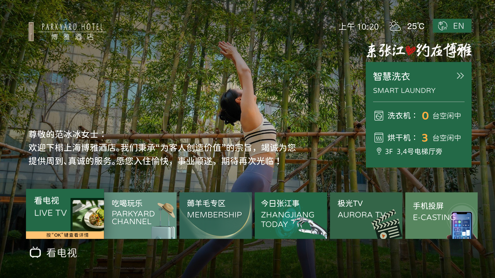

| 区域 | 位置 | 交互 |
|---|---|---|
| 底部 6 个栏目 | `112 + 292×i`, top 748，280×180 | 焦点放大 1.08 倍（从底边往上长），**提示条叠在该栏目底部、与放大后的栏目等宽**（提示条是栏目的子元素，跟着一起缩放） |
| 智慧洗衣卡 | (1419, 241)，410×410 | 未选中 / 选中两张图切换，选中那张自带橙色的「按 OK 键查看详情」条 |

键位：`←` `→` 在 6 个栏目间移动、`↑` 切到洗衣卡、`↓` 回到栏目、`OK` 打开该栏目的详情页、`返回` 回博雅欢迎页；数字 `1`–`6` 直达对应栏目。

博雅 6 个栏目的详情页（整页截图，`OK` 打开、`返回` 回到首页）：

| 栏目 | 详情截图 |
|---|---|
| 看电视 | `assets/screens/parkyard/detail/live.jpg` |
| 吃喝玩乐 | `assets/screens/parkyard/detail/channel.jpg` |
| 薅羊毛专区 | `assets/screens/parkyard/detail/member.jpg` |
| 今日张江事 | `assets/screens/parkyard/detail/zhangjiang.jpg` |
| 极光TV / 手机投屏 | 复用盛捷的 `assets/screens/somerset/home/aurora.jpg`、`cast.jpg` |

洗衣卡上按 `OK` 进 `laundry.html`（自助洗衣详情）：`↑` 洗衣机、`↓` 烘干机，`返回` 回首页；两张整页截图切换，设备卡片内容都在图里。

> 栏目素材原本是 80% 半透明，直接叠到截图上会和烘焙的旧栏目叠出重影，所以把 alpha 压成了不透明——代价是失去了设计稿里那点透过照片的质感。

## 九、诺富特（novotel-boot.html / novotel.html）

上海建滔诺富特酒店的流程：开机图停 2 秒 → 欢迎页；左侧照片区（`(0, 259)`，960×600）是 5 张轮播图，6 秒自动切；底部三个按钮用 `←` `→` 切焦点，`OK` 触发。

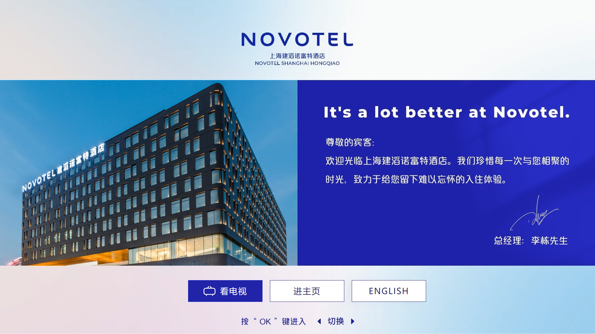

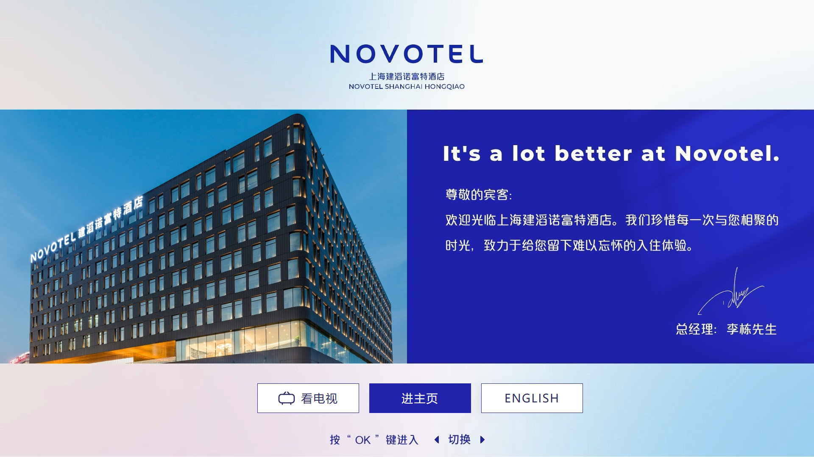

- 欢迎页本体是整页截图，只有左侧 960×600 的照片区和底部按钮是代码画的（尺寸、位置按截图量的：按钮 240×70，左边缘 607 / 871 / 1135，间距 24）；
- 按钮未选中是白底深蓝描边、选中是深蓝底白字，和设计稿的焦点态一致；
- `OK` 触发：看电视 / 进主页 → `novotel.html`；ENGLISH 暂无英文版素材，按了不跳转；
- 诺富特的欢迎页带轮播，所以它用独立开机页 `novotel-boot.html`，没有塞进通用 `boot.html`。

### 诺富特主页（novotel.html）

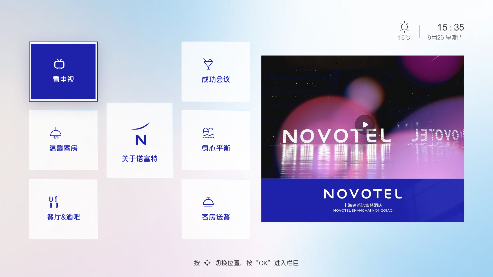

底图是设计稿截图（背景、右上时间天气、右侧视频面板、底部提示都在图里），7 个栏目用「未选中 / 选中」两张图叠着做焦点态，位置逐块对齐截图：

| 栏目 | 位置 | 尺寸 |
|---|---|---|
| 看电视 | (113, 162) | 268×234 |
| 温馨客房 | (113, 430) | 268×234 |
| 餐厅&酒吧 | (113, 698) | 268×234 |
| 关于诺富特 | (415, 400) | 258×294（比其它块高） |
| 成功会议 | (707, 162) | 268×234 |
| 身心平衡 | (707, 430) | 268×234 |
| 客房送餐 | (707, 698) | 268×234 |

方向键不是死板的二维表：按每块的中心点算「朝这个方向最近的一块」，所以中间那块偏高的「关于诺富特」也能正常走到；`OK` 打开栏目（7 个栏目全部已接详情页），`返回` 回欢迎页，数字 `1`–`7` 直达对应栏目。

#### 列表式栏目详情（novotel-list.html）

「左列表 + 右图文」这类栏目共用一个模板，靠 `?set=` 区分：

| 链接 | 内容 | 设计稿提示的翻页键 |
|---|---|---|
| `novotel-list.html?set=room` | 温馨客房：高级房 / 豪华房 / 行政房 / 普通套房 / 高级套房 | `↑` `↓` |
| `novotel-list.html?set=dining` | 餐厅&酒吧：食宜全日制西餐厅 / 悦·中餐厅 / 美食吧 / 景观餐厅 | `↑` `↓` |
| `novotel-list.html?set=meeting` | 成功会议：宴会厅&多功能厅 5 张实景 | `←` `→` |
| `novotel-list.html?set=balance` | 身心平衡：健身房&游泳池 4 张实景 | `←` `→` |
| `novotel-list.html?set=translate` | 客房送餐：菜单（单页） | `←` `→` |
| `novotel-list.html?set=about` | 关于诺富特：品牌视频 + 酒店简介（单页） | `←` `→` |
| `novotel-list.html?set=live` | 看电视：频道列表（复用博雅那张，无酒店标识） | `←` `→` |

`←` `↑` 上一页、`→` `↓` 下一页（循环），两个方向都能用；`返回` 回主页。左侧菜单的高亮、右侧照片和文案都在整页截图里，所以只是换图。

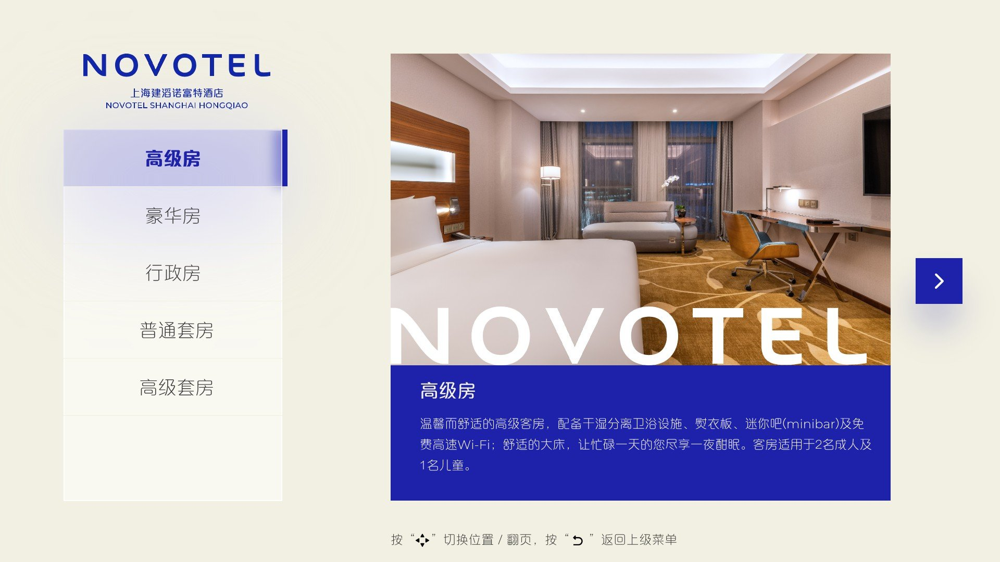

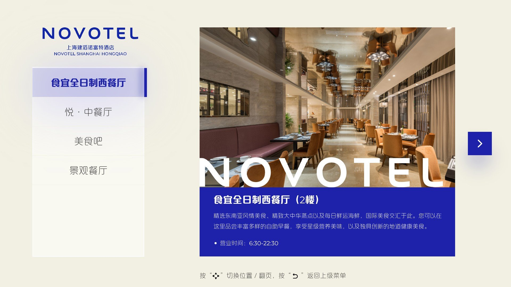

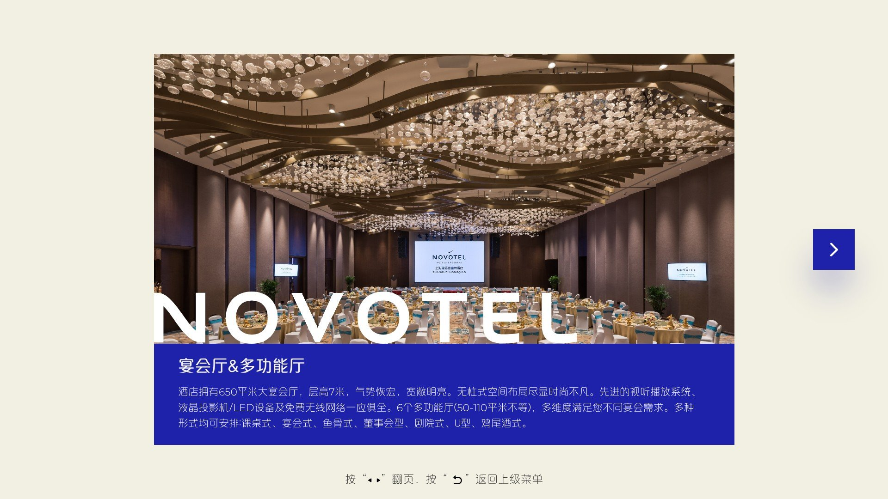

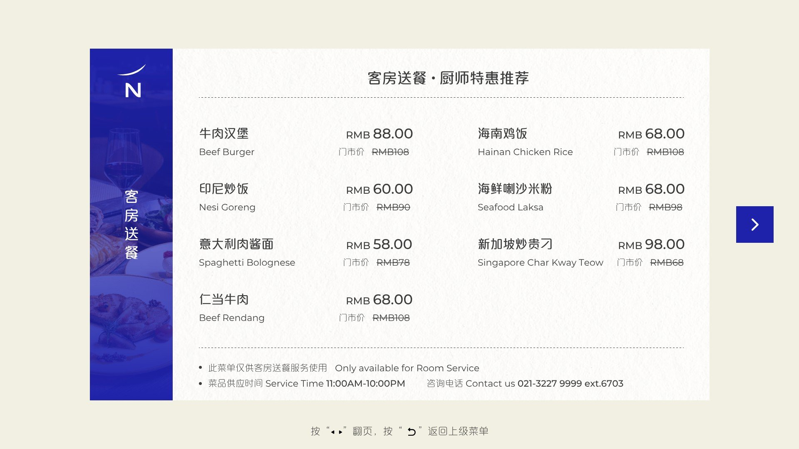

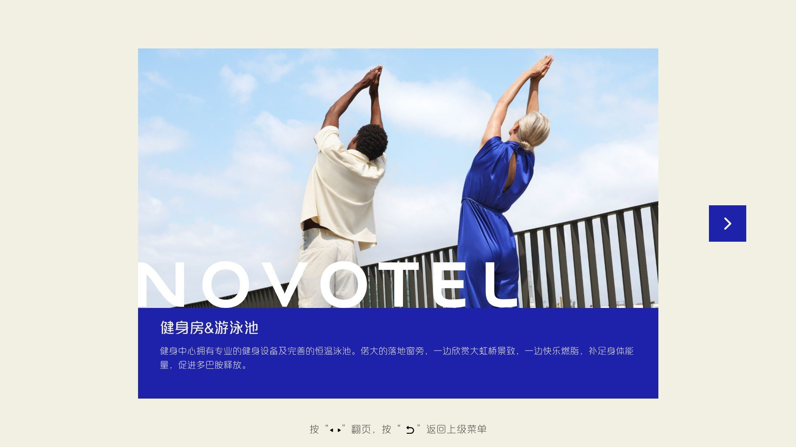

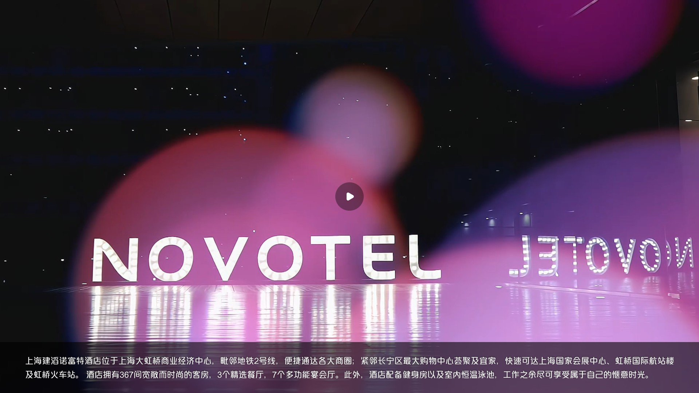

新增一个同类栏目：截图放进 `assets/screens/novotel/<目录>/`，在 `novotel-list.html` 的 `SETS` 里加一行数组，再给主页那块栏目加 `data-href="novotel-list.html?set=<key>"` 就行。

## 十、模拟电视 + 虚拟遥控（tv.html）

白底场景，左边白色电视（iframe 里跑 `boot.html?hotel=<id>` → 该酒店主页），右边白色遥控：指示灯 + 电源、方向键 + OK、返回 / 首页、1–0 数字键盘；电视左右两侧各有一个圆形 `‹` `›`，用来切换酒店。

页面底部有一行「向下滚动 · 查看作品集」的提示——滚轮一滚就进第十二节的作品集。

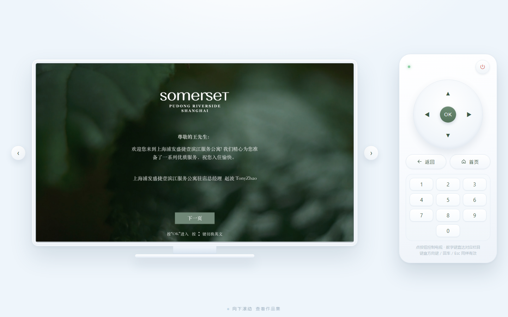

切到博雅酒店后，电视下方标签变成「博雅酒店」，画面走它的开机图 / 欢迎页：


| 按键 | 注入 | 效果 |
|---|---|---|
| ▲▼◀▶ / OK | `Arrow*` / `Enter` | 页面内焦点移动与进入 |
| 返回 | `Escape` | 关详情 / 退回上级 / 回首页 |
| 首页 | — | 电视跳到**当前酒店**的主页 |
| 1–6 | `1`…`6` | 直接跳到第 N 个栏目 |
| 电源 | — | 待机 / 唤醒；**唤醒等同重新开机**，重放当前酒店的开机 logo → 欢迎信 |
| ‹ › | — | 切换酒店，切换后自动重走该酒店的开机流程 |

原理：遥控按钮 `postMessage` 给 iframe，页面收到后派发同名 `KeyboardEvent` —— 遥控、键盘、鼠标共用一套焦点逻辑。物理键盘也能直接用（父页面把按键转给 iframe，iframe 聚焦时按键不冒泡，不会重复触发）。

## 十一、开机流程

- `boot.html?hotel=<id>`（盛捷 / 博雅）：停 2 秒淡入欢迎页 → 按 `OK` / 回车 / 点击进该酒店主页。图片路径、主页地址都写在页面顶部的 `HOTELS` 表里，加一家酒店只需加一条记录（见第四节情况 E）。`tv.html` 的 iframe 加载的就是它，切换酒店也是重新加载它；截图/演示跳过 2 秒等待：`boot.html?hotel=parkyard#welcome`。
- `novotel-boot.html`（诺富特）：开机图 2 秒 → 欢迎页（左侧 5 图轮播 + 三个按钮焦点）。
- `hampton-boot.html`（希尔顿欢朋）：两张启动图**各显示 1 秒**（logo → 品牌画面），2 秒后进主页；欢迎页素材到了插在中间即可。


### 希尔顿欢朋主页（hampton.html）

底部导航 5 项，每项是一整页截图（导航高亮、内容区都在图里），`←` `→` 切换、循环；`返回` 回开机页，数字 `1`–`5` 直达。切到「酒店」后按 `OK` 进 `hampton-hotel.html`。

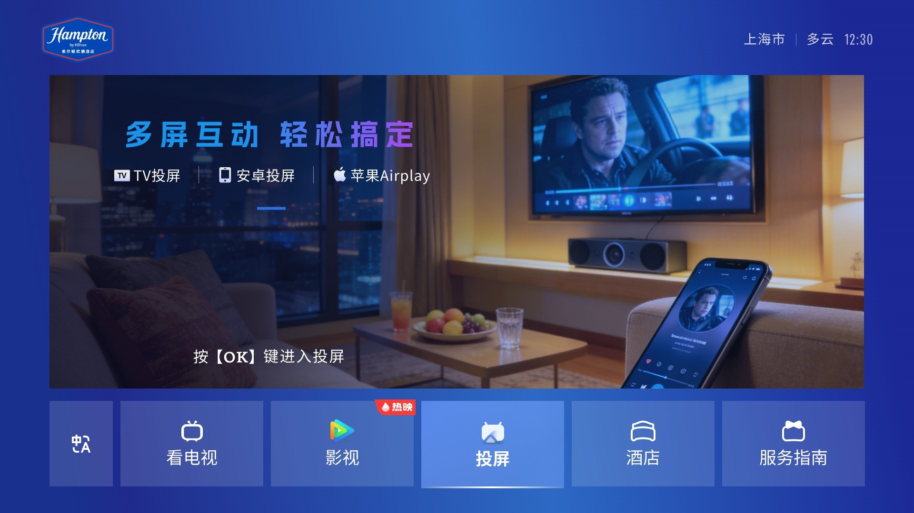

#### 酒店栏目（hampton-hotel.html）

「酒店」页右侧三张卡（客房介绍 / 餐厅介绍 / 休闲娱乐）各自有未选中 / 选中两态；左下「酒店介绍 →」文字条是截图自带的静态元素，不参与焦点。

- 方向键：`↓` 从大卡到下面两张，`←` `→` 在两张小卡之间，`↑` 回大卡；
- `OK` 打开占位页，`返回` 回主页；数字 `1`–`3` 直达三张卡。

位置按截图量的：客房 (1245,148) 572×315；餐厅 (1245,504) 267×304；休闲 (1550,504) 267×304。卡片底部的栏目名（客房介绍 / 餐厅介绍 / 休闲介绍）在原稿里是画在底图上的，卡片图盖住后改用 DOM 白字重画（27px，距底 20px，居中），选中 / 未选中都显示。

三张卡按 `OK` 进 `hampton-detail.html?set=room|dine|fun`：整页截图，`←` `→` 翻页（循环）、`返回` 回 `hampton-hotel.html`。每组目前 2 张截图，截图里印的是「1/3」，第 3 页素材到了加一条数组项即可。

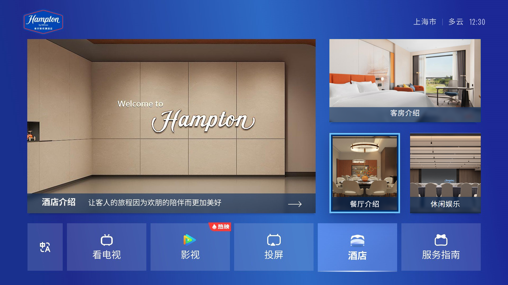

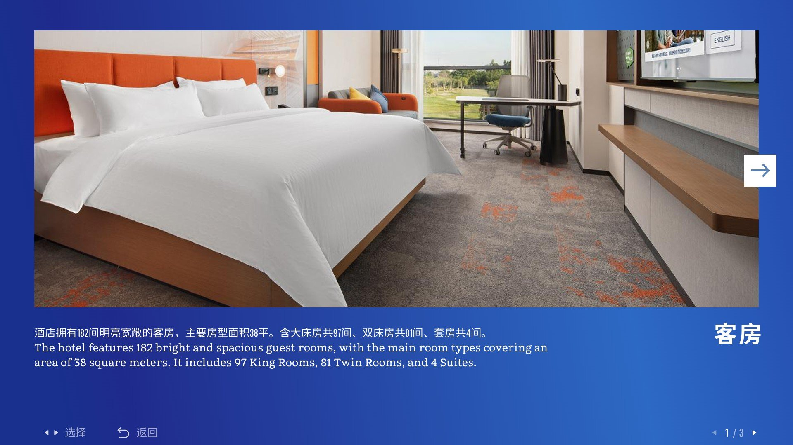

## 十二、作品集（tv.html 第二屏，正常滚动）

`tv.html` 现在是一个可以**正常往下滚**的面试演示页，前后各加了一屏：

| 屏 | 内容 |
|---|---|
| **开场** | 个人技能：六条（IPTV / 后端 / 设备对接 / RAG / MQTT / 现场） |
| 第一屏 | 模拟电视 + 虚拟遥控（四家酒店切换、开机、遥控注入） |
| 第二屏 | 作品集：18 张 3D 卡片，跟着滚动一张张过去 |
| 第三～五屏 | **设备演示集合（横向翻页）**：配送机器人 / 洗烘设备 / 人体传感器，每屏 = 演示页 + 已对接厂家 |
| 第六屏 | 设备控制：管理后台（`env-console.html`，铺满整屏、可点）+ 介绍，竖着滚「推进去」 |
| 第七屏 | 语音助手：整幅一屏，两种入口 + 三类能力（可点演示） |
| 第八屏 | MindRouter 中转站：统一入口 / 控制台 / 创作中心 |

第三～十屏连续暗色：**编号胶囊 + 薄荷绿强调色 + 屏幕框 + 玻璃卡片**，细网格做背景纹理，滚到视口才浮出（`body.js` 门控，没 JS 时内容始终可见）。

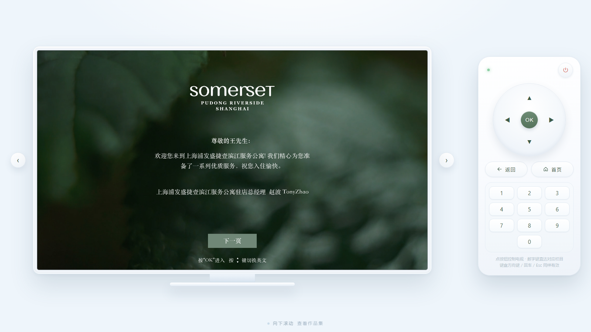

### 开场：个人技能

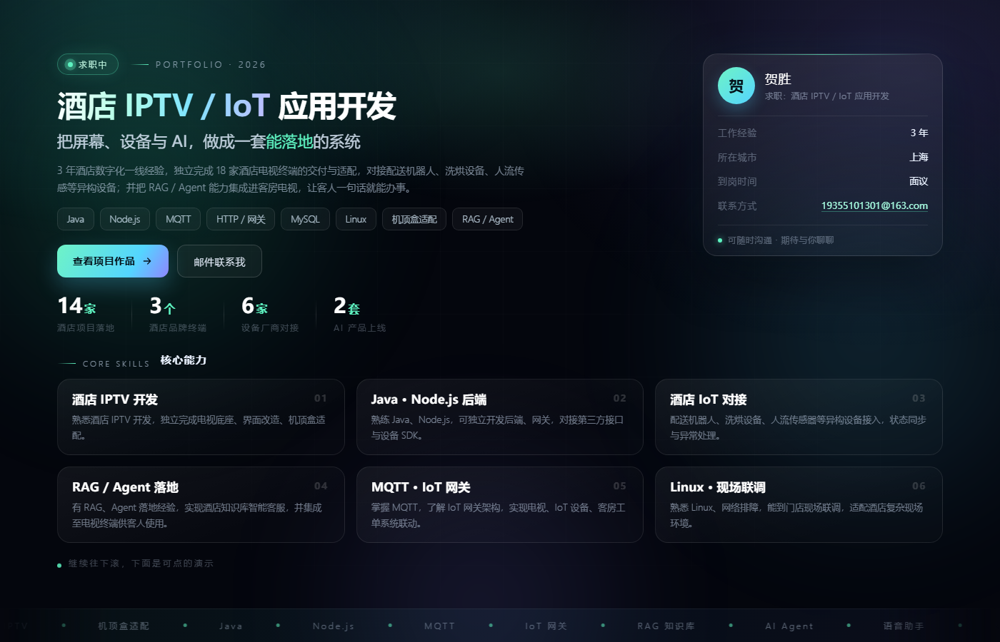

第一屏就是一页技能清单，六条，两列三行：

| | |
|---|---|
| 01 | **酒店 IPTV 开发** — 独立完成电视底座、界面改造、机顶盒适配 |
| 02 | **Java · Node.js 后端** — 可独立开发后端、网关，对接第三方接口与设备 SDK |
| 03 | **酒店 IoT 对接** — 配送机器人、洗烘设备、人流传感器等异构设备接入，状态同步与异常处理 |
| 04 | **RAG / Agent 落地** — 酒店知识库智能客服，集成至电视终端供客人使用 |
| 05 | **MQTT · IoT 网关** — 实现电视、IoT 设备、客房工单系统联动 |
| 06 | **Linux · 现场联调** — 网络排障，能到门店现场适配复杂环境 |

版式：`.intro-title` 52px 标题 + 一行副标题；`.sk-grid` 两列，每张卡左侧是薄荷色编号，右边「加粗主题 + 一行说明」，卡片 hover 有轻微上浮和薄荷描边。

### 第一屏 → 第二屏：边滚边切台

开场（暗）与电视（浅）之间不是硬切，而且电视这段**会随着滚动换酒店**：

- **电视屏钉住**：.hero 外面套了 .hero-track（高 340vh），.hero 用 position:sticky 钉住，浅色屏直接切上来（不做圆角/浮层面板），电视和遥控靠 --hc 从缩小、下移、半透明长到位；
- **开场淡出**：开场那六条技能 随滚动上浮 72px 并淡到 0.05；
- **滚动切台**：整段滚动分成 4 格，每格约 0.85 屏——第 1 格盛捷、第 2 格博雅、第 3 格诺富特、第 4 格希尔顿欢朋。切台时屏幕先淡黑（.screen.swap）、换成对方的开机页、加载完再淡回来，电视下方的酒店名和 4 个进度点同步切换；
- **整段收尾淡出**：进度过 0.8 后 .hero 整体淡到 0.21 并上移，交给作品集那一屏。

进度用轨道在文档里的绝对位置算（scrollY - trackTop），因为 sticky 之后 
ect.top 恒为 0，直接读 rect 会永远停在第一格。

### 滚动入场：每一章是一张浮起来的卡片

章节不再整段铺满屏宽，而是**一张一张圆角卡片**（1320px 宽、30px 圆角、1px 边框、顶部一道薄荷细线），随滚动浮上来：

1. **卡片浮入**：还没滚到 → 下移 96px、缩到 0.955、透明到 0.25；滚到视口下部 60% 内逐步归位到 0 / 1 / 不透；
2. **居中点亮**：卡片接近视口中央时，外发光和 1px 薄荷描边一起亮起来（--lit），像被选中；
3. **离开后退**：卡片顶部滚出视口后，往上退 26px、缩 0.02、淡到 0.78，形成一张张叠上去的层次；
4. **标题遮罩**：h2 用 clip-path 从下往上掀开（1.05s，缓动 .19,1,.22,1），编号胶囊滞后 0.12s，先淡后浮；
5. **内部错峰**：框、卡片、标签按 55ms 递增依次浮现；屏幕框额外从 0.965 缩放到 1。

这些位移值在滚动回调里同步算（不依赖 rAF），滚动条拖到哪儿就停在哪儿；prefers-reduced-motion 下全部关掉。

### 第二屏怎么动

- 这一屏的高度 = `1 屏 + (张数-1) × 0.62 屏`，画面用 `position:sticky` 钉在视口里；
- 滚动进度（`-sectionTop / (sectionH - 视口高)`）直接映射到卡片位置，所以滚多少走多少，没有劫持、没有惯性冲突；
- 松手时卡片用 0.14 的缓动追上去，停在整张之间也没关系；
- `←` `→`（或 `↑` `↓`）在作品集区域里可以跳上/下一张，用的是 `scrollTo({behavior:'smooth'})`；
- 底部信息条：该酒店 logo（白底或深色底自动选）+ 酒店名，左下 `05 / 18` 计数，右下提示，最下面进度条；
- 卡片里的「活页面」能力还留着（写 `{ name, live: 'page.html?auto=1' }` 就会渲染成 iframe 卡片），目前没启用——可操作的机器人送物已经独立成第三屏了。

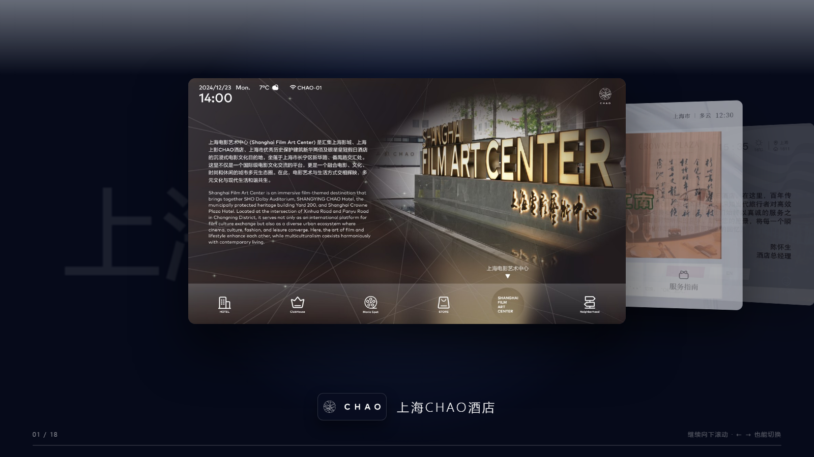

### 第三～五屏：设备演示集合（横向翻页）

三块设备合成一个**横向翻页**的集合：竖向滚一下，画面横向翻一页。每屏只有两样东西——演示页本身，和已对接的厂家。

```
┌ 01 配送机器人 ─────────────────────────────────────┐
│  ┌ 演示页（robot-delivery.html）───┐ ┌ 已对接厂家 ────┐ │
│  │ 可以上手点，真调下单接口         │ │ 云迹 / 猎户星空 │ │
│  └─────────────────────────────────┘ │ 普渡 / 洛必德   │ │
│                                       │ 覆盖率 ≈30–38%  │ │
└───────────────────────────────────────┴────────────────┘
```

- **01 配送机器人** — 演示 `robot-delivery.html`；已对接 云迹科技 / 猎户星空 / 普渡科技 / 洛必德，覆盖率 ≈30–38%
- **02 洗烘设备** — 演示 `washer-demo.html`；已对接 LG / 海尔商用智洗 / 美的 U净 / 三星，覆盖率 ≈55–65%
- **03 人体传感器** — 演示 `crowd-demo/`；右侧写**使用场景**：雷达只测人数，不拍画面、不存影像、不认人，电视上只给一句「较少 / 适中 / 较多 / 拥挤」，客人据此错峰安排时间（餐厅 / 前台 / 大堂 / 健身房）

实现：

- `.pager` 高 `300vh`，内部 `.pager-sticky` 用 `position:sticky` 钉满一屏并 `overflow:hidden`；
- `.pager-track` 是 `width:300%` 的横向轨道，三个 `.slide` 各占 `33.3333%`；
- 滚动进度 0–1 直接映射成 `translate3d(-p × 2/3 × 100%, 0, 0)`，滚多少走多少，没有滚轮劫持；
- 底部三个小圆点跟着高亮；右侧章节导航里它是一条 `01–03 · 设备演示`。

**不会滚歪**：三页各有一个吸附点（`.pager-snaps i` 位于 `0 / 100vh / 200vh`，`scroll-snap-align:start`），根节点开 `scroll-snap-type: y proximity`——只在靠近吸附点时吸，页面其他区域没有吸附点，完全不受影响。

另外停手 200ms 后还有一层补位：偏离整页超过 1.5% 就用 320ms 缓动滚回最近的一页；rAF 不跑时由定时器兜底，保证一定到位。

小圆点也可以直接点，点了就精确滚到那一页。

> 位移用百分比、不用 `100vw`——`100vw` 含滚动条宽度，会让每页错开十几像素、露出下一页的边。

### 第六屏：设备控制（滚进页面里）

这一屏不再是横向翻页，改成**竖着滚、钻进页面**——因为前面三屏已经是横向翻了，再翻一次会重复。

三段连成一个动作（`.dive`，高 `280vh`，`position:sticky` 钉住）：

1. **0 → 0.55**：管理后台先是一张 62% 大小、26px 圆角、带大投影的卡片（不倾斜），随滚动长大到铺满整屏——圆角收到 0，像镜头推近；
2. **0.45 → 0.78**：一层径向暗场压上来（最多 0.92），把注意力收住；
3. **0.52 → 0.82**：介绍浮上来（标题 / 导语 / 四张规格卡），页面同时后退 4% 做层次；滚到 0.94 之后介绍和暗场一起退场，把完整页面交回给观众。

铺满的实现：iframe 固定 1440×810 的布局尺寸，用 `transform: scale()` 放大；缩放目标 = `视口宽 / 1440`，同时把 iframe 高度设成 `视口高 / 缩放比`，所以放大到满时**正好铺满且不裁切**（左侧菜单、底部图表都在）。

> 这一屏没有吸附点、没有横向位移，就是为了和前面那段横向翻页区分开。

### 第七屏：语音助手（AI 能力）

两种入口 + 三类能力，做成了可点的演示：

- **两种入口**：电视端麦克风远场拾音 + 关键词唤醒；微信扫码绑定房间后按住手机说话；
- **三类能力**：左边三个页签（智能客服 / 电视控制 / 设备控制）各 4 句真实问法，点一句右边「房间 1001 · 语音助手」就会出现你的话、打字中的三点、再是助手回复，回复右下角带 `MCP · 送物` 这类能力标签；
- 语音「送浴巾」呼应第三屏的机器人，「调空调」呼应第六屏的温控面板。

这一屏是**整幅一屏**：.ch.vfull 取消卡片外观（无圆角/边框/投影，宽 100vw、高 100vh），内容宽 min(1680px, 94vw)，上面标题行、中间两张入口卡、下面演示区，全部一屏看完；屏幕高度低于 860px 时自动缩小字号和间距，保证仍然不滚动。

> 这一屏原来还有一张「接入层 → AI Agent → 能力层」的结构图，已经去掉，只留上面这两块。

### 第八屏：MindRouter 中转站（AI 产品）

内容提炼自 `MindRouter/MindRouter-项目介绍.md`，**创作中心是可点的真页面**：`MindRouter/creation-center-demo-v2.html` 复制成 `mindrouter-create.html`，用 iframe 嵌进来：

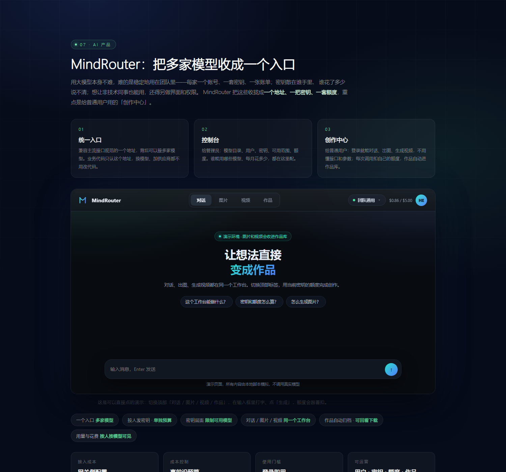

- **三部分组成**：统一入口（一个地址接多家模型，换供应商业务侧零改动）、控制台（模型目录 / 用户 / 密钥 / 额度）、创作中心（对话、出图、生成视频同一个工作台）；
- **创作中心可以直接点**：切顶部「对话 / 图片 / 视频 / 作品」，在输入框打字回车、点「生成」，额度数字会跟着扣；这块 iframe **不做等比缩放**（`.ch-frame.live` 让 iframe 按容器真实尺寸 100%×100% 渲染），所以在 1080 宽下字体和按钮都是正常大小，点得准；
- **六条能力**做成标签：一个入口多家模型 / 按人发密钥单独预算 / 密钥层面限制可用模型 / 对话·图片·视频同一工作台 / 作品自动归档 / 用量与花费按人按模型可见；
- **四张价值卡**：接入成本（网关侧配置）、成本控制（事前设预算）、使用门槛（登录即用）、可运营（用户 / 密钥 / 额度 / 作品都有归属）。

### 素材与扩展

素材来自 `D:\AoboutMe\合集`，用脚本统一处理成 `assets/portfolio/`：截图裁成 1280×720 JPEG（18 张共约 2.8 MB），logo 去透明边、限制在 300×120 以内。

**加一部作品**：图放进 `assets/portfolio/`（`19.jpg` + `19-logo.png`），在 `tv.html` 的 `WORKS` 数组末尾加一行：

```js
{ name: '某某酒店', shot: 'assets/portfolio/19.jpg', logo: 'assets/portfolio/19-logo.png' }
```

`dark: true` 表示这个 logo 是浅色的（白/银色），会自动换成深色底板；不写就是白底。

调试：`tv.html?pf=5` 打开就滚到第 5 张。

## 十三、机器人送物演示（robot-delivery.html）

从 `设备对接/robotDelivery` 里提炼出来的动效演示：那是一套酒店电视上的「机器人送物」下单页（2×3 物品网格、方向键选焦点、确认键增删、已选清单、提交下单），本身只有静态界面 + 一个提交请求。这里把整条链路做成了能看的动效。

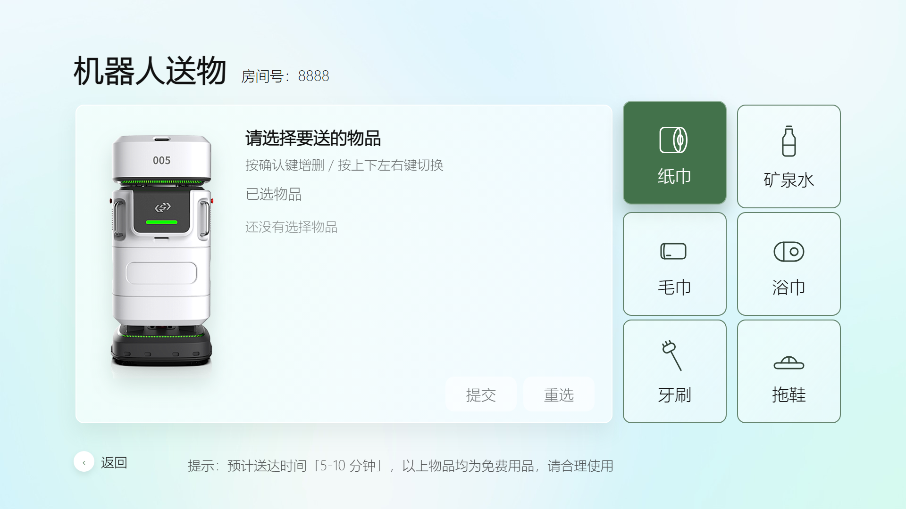

三段动效：

1. **焦点**：卡片变绿、图标与文字转白、整块上浮 8px 带投影，180ms 过渡；遥控方向键 / 鼠标悬停都走同一套；
2. **选中**：图标从卡片里飞出来，走一条向上抛的弧线落进左下「已选物品」，落到位置时清单里的条目弹一下；卡片右上角出现数量角标（弹性放大）；
3. **提交 → 真下单**：点「提交」真的调 mock 服务
   `POST http://127.0.0.1:3001/API_URL/createOrder/v2.0`（带 `appId` / `secret` 头）拿到 `orderNum`，
   之后每 1.5 秒轮询 `/API_URL/getOrderInfo`；
4. **状态驱动动效**：用返回的 `state` 和 `orderActionList` 驱动界面——顶部显示订单号 + 状态标签（待配送 / 配送中 / 已送达），
   右侧时间线逐条长出（订单已创建 → 到达取件点 → 已取件，配送中 → 已送达），机器人沿 SVG 路线走、
   路线从灰变绿、途经点逐个点亮，`DELIVERED` 时自动弹「已送达」。

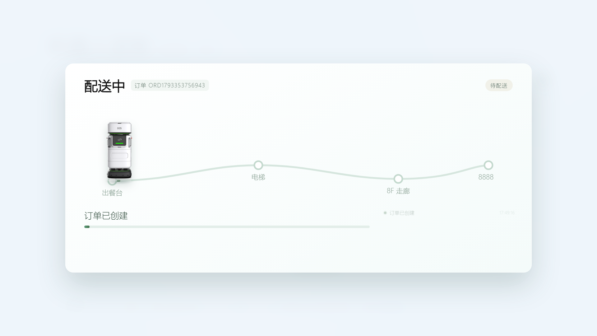

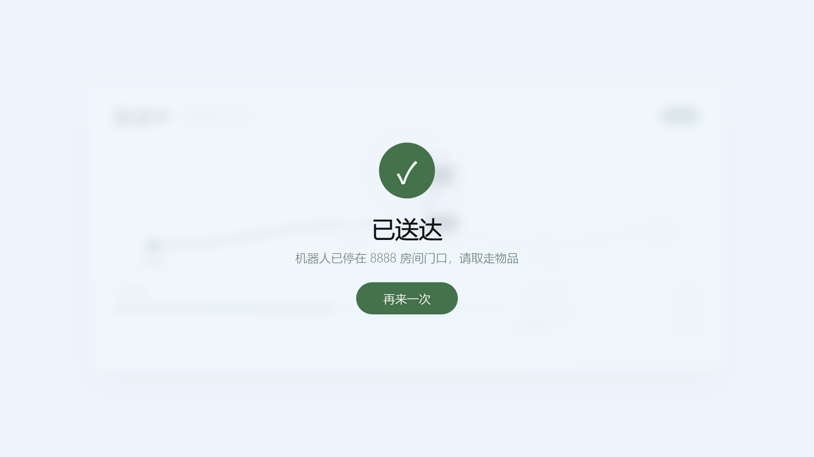

接口约定（`D:\delivery-server` 这个 mock 服务）：

| 步骤 | 请求 | 用到的返回字段 |
|---|---|---|
| 下单 | `POST /API_URL/createOrder/v2.0`，body `{source, thridOrderNum, roomNum, phone, callBackUrl, description, orderDetails[]}` | `orderNum`、`state`、`createTime` |
| 轮询 | `POST /API_URL/getOrderInfo`，body `{orderNum}` | `state`、`orderActionList[]` |

- mock 服务按创建时间推进状态：0–2s `PENDING_DELIVERY` → 2–4s `DELIVERING` → 4s+ `DELIVERED`，整条演示 **5 秒内走完**（原本是 30/60 秒）；页面侧同步改成 2/4 秒的进度映射、600ms 轮询、0.24 缓动系数；
- **服务没开也能演**：请求失败自动退化成离线演示（本地 8s / 18s 走同一套状态机），订单号显示 `OFFLINE-…`、状态文案带「（离线演示）」。

> 为了让 `file://` 打开的页面能直接调这套接口，给 `D:\delivery-server\index.js` 加了三行 CORS 中间件
> （`Access-Control-Allow-Origin: *` + 允许 `appId` / `secret` 头 + `OPTIONS` 返回 204），并把服务重启了一次。
> 不需要的话删掉那段 `app.use((req,res,next)=>{...})` 即可，页面会自动走离线演示。

| 键 | 作用 |
|---|---|
| ↑ ↓ ← → | 在 6 个物品间移动焦点（2 列） |
| OK / 回车 | 选中 / 取消当前物品 |
| 1–6 | 直达对应物品并选中 |
| Esc | 关掉配送动画 / 返回 |

素材在 `assets/robot/`（`bg.jpg` 背景、`robot.png` 机器人）。物品图标是我按同一套线描风格补的 SVG——原始工程里只带了「纸巾」一个图标（`paper.png`），其余五个没有对应素材。

联调参数：`robot-delivery.html?pick=1` 预选三件直接看清单。

## 十四、已知差异

1. **轮播张数**：参考图 5 个圆点，现只有 2 张照片 → 显示 2 个；补图自动恢复。
2. **时钟实时**：显示本机时间，参考图固定为 `2025.11 10:20`。
3. **中文标签字体**：用 `Microsoft YaHei UI Light` 近似品牌字体，字宽 ±2px。
4. **图标是位图蒙版**：1920×1080 下像素级一致，放大会略软，拿到官方 SVG 建议替换。
5. **盛捷首页的「看电视」还是占位页**：缺截图；详情页里的 `1/5`、`1/2` 翻页也只做了第 1 页，补齐截图即可（博雅这边 6 个栏目都接完了）。
6. **博雅洗衣卡的文案**：底图截图里是「自助洗衣 / 3F」，你给的卡片素材是「智慧洗衣 / 3F 3,4号电梯厅旁」，页面用的是素材版，所以卡片内容与底图略有差异。

## 十五、后续可以接着做

- 补「看电视」页面截图 → 按情况 A 挂上去，首页就全齐了；
- 自助洗衣里的设备卡片（空闲/维修/占用）目前是截图里的静态状态，接实时数据的话再按卡片做一版；
- 酒店介绍 4 个栏目的第 2…5 页截图 → 每个栏目名字后面加 `-2/-3`，把 `data-shot` 换成数组即可翻页；
- 电视端部署建议：kiosk 全屏启动、开机自启、禁用右键（文本选择已禁用）。


## 十六、版本管理（Git）

2026-11-02 第一次接上 Git，仓库就在项目根目录，默认分支 `main`。

```bash
cd D:\AoboutMe

git status                  # 看改了哪些文件
git diff tv.html            # 看某个文件改了什么
git log --oneline           # 看历史（目前只有一条「首次提交」）
```

**改坏了想回到上次提交的样子：**

```bash
git checkout -- tv.html     # 只还原一个文件（丢弃未提交的改动）
git restore .               # 还原所有未提交的改动
git reset --hard HEAD       # 所有文件都回到最近一次提交（慎用，未提交的改动会没）
```

**以后养成两个习惯：**

1. 动大改之前先提交一次：`git add -A && git commit -m "改了什么"`；
2. 每次改完确认页面没问题再提交，这样任何一次「改崩了」都能一条命令回到上一个好的版本。

> `.gitignore` 里忽略了系统垃圾文件和 `preview/tmp*.png`、`preview/srv.*.txt` 这类临时抓图；`preview/` 里的正式截图、`assets/vendor/echarts.simple.min.js` 都是提交进去的，换台机器 `git clone` 下来就能离线跑。
